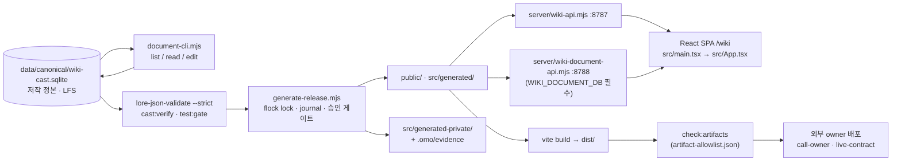

# Repository Guidelines

**갱신:** 2026-10-27 · 병렬 조사 + PR #625(`2326bf1df`, 테스트·CI 삭제) 이후 계약 기준. 현재 계약은 아래 파일들과 구현에서 직접 확인한다.

## Project Overview

서울 내부 세계를 다루는 대전략·TRPG 기반 CRPG 위키. `data/canonical/wiki-cast.sqlite`(Git LFS, schema 5)가 유일한 저작 정본이고, 승인(publication admission)을 통과한 투영만 `public/`·`src/generated/` 공개 산출물이 되어 React 18 SPA(`/wiki`)과 읽기 전용 Node API가 소비한다. 집필·승인 기준은 `WORLD_BUILDING_GUIDE.md`, 편집 절차는 `lore/AUTHORING-JSON.md`이 정본이다.

## Architecture & Data Flow



- **정본 → 생성물 단방향.** 물리적 lore JSON은 제거됐다. `.json` 이름은 DB 논리 ID/provenance일 뿐 실물 파일이 아닐 수 있다(예: `lore/World-Narrative-Atlas.json` = 논리 루트 문서 `WNA-001`, `lore/editorial/Character-System-Contract.json` = DB 내 typed 보존).
- **화면 데이터 흐름:** `src/main.tsx`(BrowserRouter basename `/wiki`) → `src/App.tsx` 라우팅. 문서 본문은 `src/documentApi.ts`의 `fetchWikiDocument(slug, locale)` → `GET /wiki/api/documents/world/<slug>?locale=ko|en` → blocks → `DocumentContent`(`@seoul-dengoku/document-renderer`) 렌더. `src/generated/wikiCatalog.ts`의 `wikiCatalog`/`wikiEnglishCatalog`는 route 등록·문서 존재 확인·언어 전환용 metadata이며 본문 로딩 경로와 별개다.
- **API:** dev에서 Vite proxy가 `/wiki/api/documents` → `127.0.0.1:8788`(문서 API), 나머지 `/wiki/api` → `127.0.0.1:8787`(데이터 API)로 보낸다. 문서 API와 generate worker(`scripts/generate-catalog.mjs`)는 동일한 `publicHouseContent`/`publicOfficeContent`/`renderLoreMarkdown` 렌더 체인을 공유한다.
- **지도:** `src/components/mapBridge.ts`가 Unity/지도 플레이어와 `MapTransport {send, subscribe}` 메시지 브리지(schema `janseon-wiki-map.v1`, EPSG:5179, manifest·source SHA-256 검증). React 측은 `useMapBridge.ts`.
- **상태 관리:** 전역 상태 라이브러리 없음. "controller factory + hook" 패턴 — `createDocumentController`(documentApi) → 페이지 ref 보관 + `useEffect` load/dispose, `createFeedbackViewController` → `hooks/useFeedbackDocument`. fetcher 주입(`fetcher: typeof fetch = fetch`), AbortController + request-id로 stale 응답 폐기.

## Key Directories

|경로|용도|경계|
|---|---|---|
|`data/`|`canonical/wiki-cast.sqlite` 정본 + `geography/` 원본 번들|export는 checkout 밖 새 경로만, 임의 SQL 편집 금지|
|`lore/`|도메인 지침(하위 AGENTS.md 다수)·논리 ID 네임스페이스|저작 절차는 `lore/AUTHORING-JSON.md` 준수|
|`src/`|React SPA. `pages/`, `components/`, `hooks/`|`src/generated*`은 생성물(gitignore)이라 직접 편집 금지|
|`public/`|공개 생성 JSON·이미지(gitignore)|항상 `npm run generate`로 재생성|
|`scripts/`|생성·검증·조회 파이프라인|정식 경계는 `generate-release.mjs`|
|`server/`|읽기 전용 공개 API 2종|`wiki-document-api.mjs`는 `WIKI_DOCUMENT_DB` 필수|
|`deploy/`|외부 owner 호출·배포 계약(Woodpecker, Dockerfile, nginx, ps1)|저장소는 호스트 자격증명 미보유|
|`snapshots/build-inputs/`|고정 외부 입력(atlas-data.js 등)|generate 소비 대상, 재수집 아님|
|`.omo/`|비공개 작업·증거·editorial/Soul DB|git·공개 산출물에서 제외|
|`docs/`, `assets/`, `vendor/`|운영 계약·문장 모티프 원본·tgz 의존성 + InkOS 서브모듈|`vendor/seoul-dengoku-inkos`는 격리 사용|

## Development Commands

```bash
npm ci --ignore-scripts                                  # 표준 설치(postinstall 미실행)
npm run dev                                              # Vite dev — http://localhost:5174/wiki
npm run generate                                         # scripts/generate-release.mjs — 공개 생성물 재생성
npm run build                                            # generate-release.mjs --build → dist/
npm run cast:build -- --output /tmp/wiki-cast-new.sqlite # export — checkout 밖 경로만 허용
npm run cast:verify -- --db data/canonical/wiki-cast.sqlite
npm run check:artifacts                                  # dist/ ↔ artifact-allowlist.json 대조
node scripts/check-contract.mjs                          # 산출 계약 검사(npm 스크립트 없음 — 직접 실행)
node scripts/lore-json-validate.mjs --strict             # 문서 스키마·로케일·블록·링크 검사
node scripts/document-cli.mjs --db data/canonical/wiki-cast.sqlite list   # 정본 문서 조회
node --test --test-concurrency=1 scripts/cast-sqlite/test-inkos-adapter-*.mjs   # 어댑터 회귀(PR #627 병합 후)
node server/wiki-api.mjs                                 # PORT=8787 HOST=0.0.0.0 DATA_DIR=public/
WIKI_DOCUMENT_DB=... node server/wiki-document-api.mjs   # 문서 API(환경변수 필수)
```

테스트 npm 스크립트(`npm test`, `test:parent`, `test:cast-sqlite` 등)는 PR #625에서 제거됐다. 검사·시험은 위처럼 직접 node 실행한다.

문서 편집은 `document-cli.mjs edit` — stdin typed 명령 배열 + `--expected-revision --actor --reason` 필요. 편집은 draft 생성일 뿐 승인을 의미하지 않는다.

## Code Conventions & Common Patterns

- **SQLite-first 저작.** 문서·인물·세력 변경은 DB 편집으로. `public/`·`src/generated*` 직접 수정 금지.
- **승인 게이트.** `generate-release.mjs`의 `requireGenerationPublication()`이 review `complete` + `semanticReview === 'reviewed'`를 요구(`E_PUBLICATION_REVIEW_PENDING`). `published`·`source_present`·`issued` 따위 개별 플래그로 공개 승인을 추론하지 않는다.
- **ESM + TypeScript strict.** `"type": "module"`, tsconfig 단일 파일(noEmit, bundler resolution, `@/*` → `src`). 네이밍: 컴포넌트 PascalCase(`ArticlePage.tsx`), 유틸 camelCase, 도메인 유틸은 `wiki*` 접두사(`wikiRouting.ts`, `wikiDocument.ts`).
- **비동기·에러 패턴.** async/await + AbortController + request counter 가드, fire-and-forget은 `void controller.load(...)`. 로딩/오류/미발견 상태를 합치지 않고 명시적 union(`'ready'|'loading'|'not-found'|'error'`)으로 모델링. API 클라이언트는 typed error envelope 파싱(예: `FeedbackApiError`).
- **린트·포맷터 부재.** ESLint/Prettier/Biome 없음 — 품질 장치는 tsc strict + 저장소 검사 스크립트(`check-contract`, `check-links`, `check-artifact-allowlist`, `lore-json-validate`).
- **비공개 경계.** `src/generated-private/`(제보 서비스 전용, 프런트 import·`public/` 복사 금지), `.omo/private/`(mode 600), soul·역사 모티브·증거 원천은 공개 JSON·asset·번들에 포함 금지.

### 기존 소유자 정책(원문 그대로 유지)

- 세계관·인물·세력·무공·아이템·대사·위키를 작성·수정·검토하기 전에 [WORLD_BUILDING_GUIDE.md](WORLD_BUILDING_GUIDE.md)를 끝까지 읽는다. 이 지침은 이 저장소의 집필·기여 표면에 적용하며, 최신 사용자·디렉터 지시와 승인 상태를 함께 대조한다. 무공 분류는 그 가이드와 명명 원장의 승인본을 따르고, 옛 여덟 유파·여섯 분류·현장 별칭 문장으로 되돌리지 않는다.
- Work on a dedicated branch and deliver changes through a pull request to `main`; the owner alone merges it.
- Use Korean conventional-commit messages for independently verified changes.
- Do not push directly to `main` or rewrite shared history.
- 재사용성이 불가능한 테스트 스크립트는 작성하지 않는다. 데이터 이관은 먼저 완료한 뒤 이관 결과를 검토하며, 기존 검증 도구를 우선 사용한다.
- 미정 항목은 AI가 원천·기존 설정·외부 자료를 적극 조사해 근거와 구체적인 후보를 마련하고, 사용자 판단이 필요한 부분은 질문해 끝까지 확정한다. 미정으로 표시하거나 최종 보고에 나열하는 것만으로 완료하지 않으며, 답변 전에는 후보를 승인된 설정으로 기록하지 않는다.

## Important Files

|파일|역할|
|---|---|
|`WORLD_BUILDING_GUIDE.md`|집필·승인 기준 정본(역량 척도, 서울 유일 세계, 지리 계층, 증거 위계)|
|`lore/AUTHORING-JSON.md`|문서 저작·편집 절차(envelope v1, status draft/approved/excluded)|
|`src/main.tsx` / `src/App.tsx`|진입점·전체 라우팅(basename `/wiki`, legacy redirect 포함)|
|`src/documentApi.ts`|문서 fetch controller(요청 검증·경합 가드)|
|`src/pages/ArticlePage.tsx`, `src/pages/PersonDetailPage.tsx`|기사 본문·공개 인물 상세 대표 화면|
|`src/components/mapBridge.ts`|Unity 지도 브리지 계약|
|`scripts/generate-release.mjs`|정식 generate/build 경계(flock lock, journal, 승인 게이트, 원자적 쓰기)|
|`scripts/generate-catalog.mjs`|generate worker. 직접 실행으로 live 출력 갱신·stage 우회 금지|
|`scripts/cast-sqlite/document-cli.mjs`|SQLite 문서 list/read/edit|
|`scripts/cast-sqlite/db.mjs`|SCHEMA_VERSION=5, APPLICATION_ID=0x57435351|
|`scripts/cast-sqlite/verify.mjs`, `current-authority.mjs`|정본 무결성·현재성 검증(`cast:verify`)|
|`scripts/document-store/`|비공개 문서·receipt·pinned reader|
|`scripts/inkos-adapter/README.md`|InkOS 후보 전용·읽기 전용 경계|
|`server/wiki-api.mjs`, `server/wiki-document-api.mjs`|공개 API|
|`deploy/call-owner.mjs`, `deploy/check-live-contract.mjs`, `deploy/README.md`|외부 owner 배포 계약|
|`artifact-allowlist.json`|dist/ 산출물·라우트 허용 목록(루트에 위치)|
|`vite.config.ts`, `tsconfig.json`|빌드·타입 설정(vitest 설정은 #625에서 삭제)|
|`.woodpecker/deploy.yaml`|유일한 CI 파이프라인 — LFS 검사 → owner 호출 → live contract(`ci.yaml`·GitHub workflows는 #625 삭제)|

## Runtime/Tooling Preferences

- **Node:** README 기준 `>=22.16.0`, cast-sqlite(`node:sqlite` `DatabaseSync`)은 `>=24.15.0`, 배포 파이프라인(`.woodpecker/deploy.yaml`)은 Node 26 이미지. `engines`/`packageManager` 필드는 없다(문서 계약).
- **패키지 매니저:** npm(package-lock). `npm ci --ignore-scripts`가 표준. pnpm은 InkOS 포크 전용 — `npm run inkos:install`이 `npm exec --package=pnpm@10`으로 격리 설치·빌드한다.
- **InkOS 포크**(`vendor/seoul-dengoku-inkos` 서브모듈)는 별도 작업 디렉터리·별도 프로세스에서만. 공개 정본·비공개 DB를 읽거나 쓰도록 연결하지 않고, 위키 검사·생성·배포 입력에 포함하지 않는다.
- 로어 schema 검사는 Python `jsonschema` 필요. release lock은 Python `fcntl.flock`(Windows 즉시 실행 단정 금지, exit 73 = `E_RELEASE_LOCKED`). lock은 협조하는 generate/build만 보호하므로 생성 중 dev·직접 tsc/vite reader는 중지한다.
- build/gate/검사는 MongoDB 없이 동작한다(`db:load`는 별개).

## Testing & QA

- **테스트 인프라 제거(#625):** vitest·jsdom, npm 테스트 스크립트 전부, `.woodpecker/ci.yaml`, GitHub Actions 2종, `deploy/test-*.mjs`가 삭제됐다. 테스트 npm 스크립트·vitest 의존 재추가 금지(postgres 이관 Wave 0 계약).
- **잔존 실행 회귀:** 승인 경계 어댑터 6종만 `node --test --test-concurrency=1 scripts/cast-sqlite/test-inkos-adapter-*.mjs`로 직접 실행한다(PR #627). InkOS 스모크 `scripts/test-inkos.mjs`는 PR #623 병합 후 master 고정 기대값으로 복원 예정. 직렬 실행 권고 — `io.mjs` 조상 ctime 검사가 병렬에서 `E_ADAPTER_PATH` 오탐을 낸다.
- **품질 장치:** lint·포맷터 없음 — tsc strict + 검사 스크립트(`check-contract.mjs`, `check-links.mjs`, `check-artifact-allowlist.mjs`, `lore-json-validate.mjs`, `cast:verify` 등). 커버리지 설정 없음.
- **CI:** `.woodpecker/deploy.yaml`만 존재 — `deploy/check-lfs-inputs.mjs` → `npm ci --ignore-scripts` → `deploy/call-owner.mjs`(외부 owner) → `deploy/check-live-contract.mjs --public-edge`.
- **사전 조건:** generated catalog가 필요한 작업은 `npm run generate` 선행. Git LFS 입력(`data/canonical/wiki-cast.sqlite`, `public/portraits/person-1017.png`) 필수.
