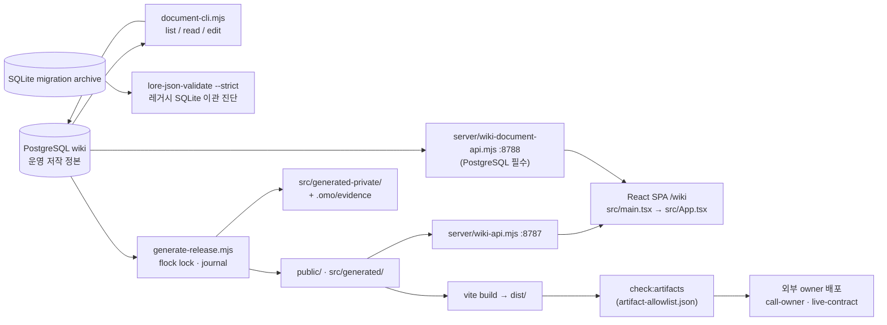

# Repository Guidelines

**갱신:** 2026-10-31 · PostgreSQL 운영 정본, 한국어 공개 문서, 무협 제거 이후 계약 기준. 현재 명령과 구현은 아래 파일들에서 확인하고 과거 PR·이관·배포 기록을 현재 완료 상태와 구분한다.

## Project Overview

서울 내부 세계를 다루는 대전략·TRPG 기반 CRPG 위키. PostgreSQL `wiki`가 현재 운영 저작 정본이며 typed 문서 head·revision을 보유한다. 공개 생성물은 `public/`·`src/generated/`에 투영되어 React SPA와 읽기 전용 API가 소비한다. PG 문서 저작과 API는 SQLite 폴백이 없다. 운영 승격은 wiki 커밋 `24f3c676f7df0b9903e02f4278ac65bf8fac688f`, run `20261030T150126Z-11560`에서 `deployed`로 확인됐다(`deploy/README.md` 운영 관측). 앞선 격리 환경의 SQLite·PG reader 및 전체 worker 출력 1,433개 대사와 일반 PG 빌드·검사 통과는 별도 이관 검증 기록이다. 집필·승인 기준은 `WORLD_BUILDING_GUIDE.md`, 편집 절차는 `lore/AUTHORING-JSON.md`을 따른다.

## Architecture & Data Flow



- **정본 → 생성물 단방향.** 물리적 lore JSON은 제거됐다. `.json` 이름은 DB 논리 ID/provenance일 뿐 실물 파일이 아닐 수 있다(예: `lore/World-Narrative-Atlas.json` = 논리 루트 문서 `WNA-001`, `lore/editorial/Character-System-Contract.json` = DB 내 typed 보존).
- **이관과 증거 구분.** 이관 완료된 추적 `data/canonical/wiki-cast.sqlite`는 제거됐다. 외부 SQLite는 경로를 명시한 이관·대사에만 사용하며 운영 런타임 입력이나 편집 정본이 아니다. 다른 archive와 이전 배포 롤백은 보존한다. PG 내부 `wiki.source_file` 원천 바이트·해시, `source_record` provenance, 봉인 revision도 불변으로 보존하며 삭제·재작성하지 않는다. 잔존 이관·회귀 코드를 운영 저작 도구로 혼동하지 않는다.
- **전환 게이트.** `--verify-pg`는 공개 `WIKI_DOCUMENT_PG[_FILE]`와 별도 비공개 `WIKI_GENERATION_PRIVATE_PG[_FILE]` 연결을 사용해 stage만 검증하고 승격하지 않는다. 일반 PG 생성·빌드는 메타데이터, PostgreSQL 스냅샷과 비공개 입력 스냅샷·출처 검증을 유지한다. 격리 환경의 통과와 정확한 SHA/run의 운영 승격은 별도 증거다. 잔존 SQLite 생성 경로는 `WIKI_MIGRATION_SQLITE=1`과 외부 `WIKI_DOCUMENT_DB`를 명시한 이관 진단 전용이며 런타임 폴백이 아니다.
- **화면 데이터 흐름:** `src/main.tsx`(BrowserRouter basename `/wiki`) → `src/App.tsx` 라우팅. 문서 본문은 `src/documentApi.ts` → `GET /wiki/api/documents/world/<slug>?locale=ko` → blocks → `DocumentContent` 렌더. 공개 본문은 한국어 전용이며 영어 카탈로그·영어 생성 문서는 폐기됐다.
- **API:** dev에서 Vite proxy가 `/wiki/api/documents` → `127.0.0.1:8788`(문서 API), 나머지 `/wiki/api` → `127.0.0.1:8787`(데이터 API)로 보낸다. 문서 API와 generate worker(`scripts/generate-catalog.mjs`)는 동일한 `publicHouseContent`/`publicOfficeContent`/`renderLoreMarkdown` 렌더 체인을 공유한다.
- **지도:** `src/components/mapBridge.ts`가 Unity/지도 플레이어와 `MapTransport {send, subscribe}` 메시지 브리지(schema `janseon-wiki-map.v1`, EPSG:5179, manifest·source SHA-256 검증). React 측은 `useMapBridge.ts`.
- **상태 관리:** 전역 상태 라이브러리 없음. "controller factory + hook" 패턴 — `createDocumentController`(documentApi) → 페이지 ref 보관 + `useEffect` load/dispose, `createFeedbackViewController` → `hooks/useFeedbackDocument`. fetcher 주입(`fetcher: typeof fetch = fetch`), AbortController + request-id로 stale 응답 폐기.

## Key Directories

|경로|용도|경계|
|---|---|---|
|`data/`|지리 원본 번들과 이전 SQLite 이관 입력|SQLite는 운영 저작 정본 아님; PG 역사 증거와 구별|
|`lore/`|도메인 지침(하위 AGENTS.md 다수)·논리 ID 네임스페이스|저작 절차는 `lore/AUTHORING-JSON.md` 준수|
|`src/`|React SPA. `pages/`, `components/`, `hooks/`|`src/generated*`은 생성물(gitignore)이라 직접 편집 금지|
|`public/`|공개 생성 JSON·이미지(gitignore)|항상 `npm run generate`로 재생성|
|`scripts/`|생성·검증·조회 파이프라인|정식 경계는 `generate-release.mjs`|
|`server/`|읽기 전용 공개 API 2종|문서 API는 `WIKI_DOCUMENT_PG` 또는 `WIKI_DOCUMENT_PG_FILE` 필수|
|`deploy/`|외부 owner 호출·배포 계약(Woodpecker, Dockerfile, nginx, ps1)|저장소는 호스트 자격증명 미보유|
|`snapshots/build-inputs/`|고정 외부 입력(atlas-data.js 등)|generate 소비 대상, 재수집 아님|
|`.omo/`|비공개 작업·증거·editorial/Soul DB|git·공개 산출물에서 제외|
|`docs/`, `assets/`, `vendor/`|운영 계약·문장 모티프 원본·tgz 의존성 + InkOS 서브모듈|`vendor/seoul-dengoku-inkos`는 격리 사용|

## Development Commands

```bash
npm ci --ignore-scripts                                  # 표준 설치(postinstall 미실행)
npm run dev                                              # Vite dev — http://localhost:5174/wiki
npm run generate                                         # release 진입점; PG 메타데이터·스냅샷 검증 필요
npm run build                                            # release --build; 동일 PG 검증 경계 적용
node scripts/generate-release.mjs --verify-pg             # PG 공개·비공개 연결 필요; stage 검증만
# cast:pg-verify는 이관 입력 필요; --pg 인자 자격증명 노출에 주의
npm run check:artifacts                                  # dist/ ↔ artifact-allowlist.json 대조
node scripts/check-contract.mjs                          # 산출 계약 검사(npm 스크립트 없음 — 직접 실행)
WIKI_DOCUMENT_DB=/absolute/path/to/migration.sqlite node scripts/lore-json-validate.mjs --strict # 외부 SQLite 이관 진단
node scripts/cast-sqlite/document-cli.mjs list --corpus current # WIKI_AUTHORING_PG 또는 WIKI_DOCUMENT_PG
# 어댑터 7파일은 아래 Testing & QA의 삭제 DB 고정경로 의존으로 현재 실행 제한
node --test scripts/test-inkos.mjs                        # 격리 InkOS pin·CLI 스모크
node server/wiki-api.mjs                                 # PORT=8787 HOST=0.0.0.0 DATA_DIR=public/
node server/wiki-document-api.mjs                        # WIKI_DOCUMENT_PG 또는 WIKI_DOCUMENT_PG_FILE
```

테스트 npm 스크립트(`npm test`, `test:parent`, `test:cast-sqlite` 등)는 PR #625에서 제거됐다. 검사·시험은 위처럼 직접 node 실행한다.

문서 편집은 `document-cli.mjs edit` — stdin typed 명령 배열 + `--expected-revision --actor --reason` 필요. 편집은 draft 생성일 뿐 승인을 의미하지 않는다.

## Code Conventions & Common Patterns

- **PostgreSQL 운영 저작.** 지원되는 typed CLI로 문서 변경; `public/`·`src/generated*` 직접 수정 금지. SQLite writer와 검사는 이관·대사용이며 PG 정본 편집 수단이 아니다.
- **승인 경계.** 편집은 draft이며 기존 승인을 승계하지 않는다. 원천 승인·게시 편입·생성·배포는 별도 판단으로 보존하고, 실행된 검증 이상의 승인이나 배포를 주장하지 않는다.
- **ESM + TypeScript strict.** `"type": "module"`, tsconfig 단일 파일(noEmit, bundler resolution, `@/*` → `src`). 네이밍: 컴포넌트 PascalCase(`ArticlePage.tsx`), 유틸 camelCase, 도메인 유틸은 `wiki*` 접두사(`wikiRouting.ts`, `wikiDocument.ts`).
- **비동기·에러 패턴.** async/await + AbortController + request counter 가드, fire-and-forget은 `void controller.load(...)`. 로딩/오류/미발견 상태를 합치지 않고 명시적 union(`'ready'|'loading'|'not-found'|'error'`)으로 모델링. API 클라이언트는 typed error envelope 파싱(예: `FeedbackApiError`).
- **린트·포맷터 부재.** ESLint/Prettier/Biome 없음 — 품질 장치는 tsc strict + 저장소 검사 스크립트(`check-contract`, `check-links`, `check-artifact-allowlist`, `lore-json-validate`).
- **비공개 경계.** `src/generated-private/`(제보 서비스 전용, 프런트 import·`public/` 복사 금지), `.omo/private/`(mode 600), soul·역사 모티브·증거 원천은 공개 JSON·asset·번들에 포함 금지.

### 소유자 정책

- 세계관·인물·세력·훈련·아이템·대사·위키를 작성·수정·검토하기 전에 [WORLD_BUILDING_GUIDE.md](WORLD_BUILDING_GUIDE.md)를 끝까지 읽는다. 최신 사용자·디렉터 지시와 승인 상태를 함께 대조한다. 무공 체계와 무협 설정은 폐기됐으므로 옛 유파·초식·명명 원장의 보존 기록을 현재 집필 기준으로 재사용하지 않는다. 서울 유일 세계·현재 역량 및 숙련 체계·한국어 공개 본문 기준을 따른다.
- Work on a dedicated branch and deliver changes through a pull request to `main`; the owner alone merges it.
- Use Korean conventional-commit messages for independently verified changes.
- Do not push directly to `main` or rewrite shared history.
- 재사용성이 불가능한 테스트 스크립트는 작성하지 않는다. 데이터 이관은 먼저 완료한 뒤 이관 결과를 검토하며, 기존 검증 도구를 우선 사용한다.
- 미정 항목은 AI가 원천·기존 설정·외부 자료를 적극 조사해 근거와 구체적인 후보를 마련하고, 사용자 판단이 필요한 부분은 질문해 끝까지 확정한다. 미정으로 표시하거나 최종 보고에 나열하는 것만으로 완료하지 않으며, 답변 전에는 후보를 승인된 설정으로 기록하지 않는다.

## Important Files

|파일|역할|
|---|---|
|`WORLD_BUILDING_GUIDE.md`|집필·승인 기준 정본(역량 척도, 서울 유일 세계, 지리 계층, 증거 위계)|
|`lore/AUTHORING-JSON.md`|문서 저작·편집 절차(envelope v1, status draft/approved/excluded)|
|`src/main.tsx` / `src/App.tsx`|진입점·전체 라우팅(basename `/wiki`, legacy redirect 포함)|
|`src/documentApi.ts`|문서 fetch controller(요청 검증·경합 가드)|
|`src/pages/ArticlePage.tsx`, `src/pages/PersonDetailPage.tsx`|기사 본문·공개 인물 상세 대표 화면|
|`src/components/mapBridge.ts`|Unity 지도 브리지 계약|
|`scripts/generate-release.mjs`|정식 generate/build 경계(flock lock, journal, 원자적 쓰기)|
|`scripts/generate-catalog.mjs`|generate worker. 직접 실행으로 live 출력 갱신·stage 우회 금지|
|`scripts/cast-sqlite/document-cli.mjs`|PostgreSQL 문서 list/read/edit; `--db` 및 SQLite 폴백 불가|
|`scripts/cast-sqlite/db-pg.mjs`|PostgreSQL 비동기 reader; `db.mjs`는 SQLite 이관 도구|
|`scripts/cast-sqlite/verify.mjs`, `scripts/postgres-migration/reconcile.mjs`|SQLite 이관 입력 검사·PG 대사; 운영 승인·배포 증명이 아님|
|`scripts/document-store/`|비공개 문서·receipt·pinned reader|
|`scripts/inkos-adapter/README.md`|InkOS 후보 전용·읽기 전용 경계|
|`server/wiki-api.mjs`, `server/wiki-document-api.mjs`|공개 API|
|`deploy/call-owner.mjs`, `deploy/check-live-contract.mjs`, `deploy/README.md`|외부 owner 배포 계약|
|`artifact-allowlist.json`|dist/ 산출물·라우트 허용 목록(루트에 위치)|
|`vite.config.ts`, `tsconfig.json`|빌드·타입 설정(vitest 설정은 #625에서 삭제)|
|`.woodpecker/deploy.yaml`|유일한 CI 파이프라인 — LFS 검사 → owner 호출 → live contract(`ci.yaml`·GitHub workflows는 #625 삭제)|

## Runtime/Tooling Preferences

- **Node:** 배포 파이프라인(`.woodpecker/deploy.yaml`)은 Node 26 이미지다. 잔존 SQLite 이관 도구(`node:sqlite` `DatabaseSync`)는 `>=24.15.0`, 격리 InkOS 포크 도구는 `>=22.16.0`을 요구한다. `package.json`에는 `engines`/`packageManager` 필드가 없다.
- **패키지 매니저:** npm(package-lock). `npm ci --ignore-scripts`가 표준. pnpm은 InkOS 포크 전용 — `npm run inkos:install`이 `npm exec --package=pnpm@10`으로 격리 설치·빌드한다.
- **InkOS 포크**(`vendor/seoul-dengoku-inkos` 서브모듈)는 별도 작업 디렉터리·별도 프로세스에서만. 공개 정본·비공개 DB를 읽거나 쓰도록 연결하지 않고, 위키 검사·생성·배포 입력에 포함하지 않는다.
- 로어 schema 검사는 Python `jsonschema` 필요. release lock은 Python `fcntl.flock`(Windows 즉시 실행 단정 금지, exit 73 = `E_RELEASE_LOCKED`). lock은 협조하는 generate/build만 보호하므로 생성 중 dev·직접 tsc/vite reader는 중지한다.
- build/gate/검사는 MongoDB 없이 동작한다(`db:load`는 별개).

## Testing & QA

- **테스트 인프라 제거(#625):** vitest·jsdom, npm 테스트 스크립트 전부, `.woodpecker/ci.yaml`, GitHub Actions 2종, `deploy/test-*.mjs`가 삭제됐다. 테스트 npm 스크립트·vitest 의존 재추가 금지(postgres 이관 Wave 0 계약).
- **잔존 회귀와 실행 한계:** 승인 경계 어댑터 7파일은 남아 있지만 fixture가 `authoring-schema-documents.mjs`에서 제거된 `data/canonical/wiki-cast.sqlite`를 고정경로로 연다. `WIKI_DOCUMENT_DB`만 지정해도 이 의존성은 바뀌지 않는다. 2026-10-31 `node --test --test-concurrency=1 scripts/cast-sqlite/test-inkos-adapter-*.mjs scripts/test-inkos.mjs` 실행은 110개 중 11개 성공·99개 실패했으며 어댑터 fixture에서 `E_DB_OPEN`이 관측됐다. 테스트를 통과시키려고 삭제 DB를 복원하지 않는다. 별도 코드 이관 전에는 checkout 단독 실행 가능한 회귀로 안내하지 않는다. 같은 실행에서 격리 InkOS pin·owner remote·master 설정 검사와 CLI 전달·한국어 프로젝트 초기화 스모크 두 개는 통과했다. 어댑터를 다시 이관·검증할 때는 `io.mjs` 조상 ctime 검사의 병렬 오탐을 피하도록 직렬 실행한다.
- **품질 장치:** lint·포맷터 없음 — tsc strict + 검사 스크립트(`check-contract.mjs`, `check-links.mjs`, `check-artifact-allowlist.mjs`, `lore-json-validate.mjs`, `cast:verify` 등). 커버리지 설정 없음.
- **CI:** `.woodpecker/deploy.yaml`만 존재 — `deploy/check-lfs-inputs.mjs` → `npm ci --ignore-scripts` → `deploy/call-owner.mjs`(외부 owner) → `deploy/check-live-contract.mjs --public-edge`.
- **사전 조건:** generated catalog가 필요한 작업은 생성 입력과 전환 게이트를 확인한다. `check-links.mjs`는 일반 Markdown 링크 검사기가 아니라 생성 카탈로그·world·dist와 SQLite 이관 문서 링크를 검사하므로, 필요한 생성물과 외부 `WIKI_DOCUMENT_DB` 없이 PG 정본 검사로 실행하지 않는다. `lore-json-validate`·`cast:verify` 역시 외부 SQLite 이관 진단이며 PG 정본 검증을 대신하지 않는다. 이관 대사에는 정확한 SQLite 실체와 PG 연결이 필요하다. Git LFS 입력은 실제 필요한 작업의 계약을 확인한다.
